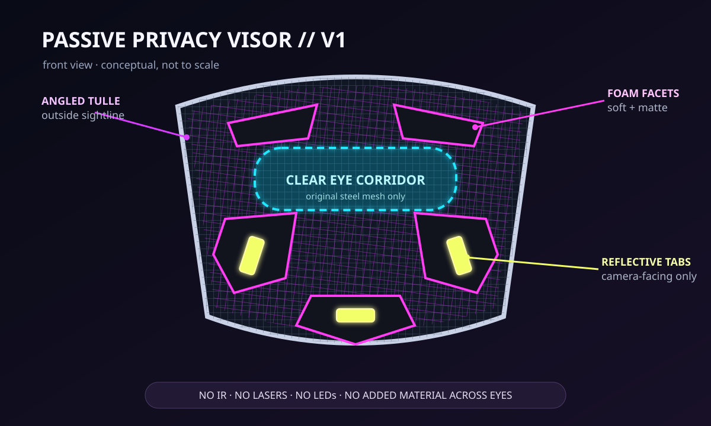

# Passive Privacy Visor

An eye-safe, build-now wearable that makes a face look fragmented and cyberpunk in ordinary camera recordings. The design is entirely passive: a steel-mesh faceguard carries a removable angled tulle screen, matte faceted foam panels, and outward-facing retroreflective accents.



## What it can and cannot do

The visor physically hides stable facial landmarks and can produce moving moire patterns when the camera samples its overlapping grids. Flash or a near-camera lamp can make the reflective accents bloom. The result depends on the camera, distance, focus, compression, and lighting.

This is **not** an invisibility device and does not guarantee anonymity or defeat every face-recognition system. A camera may still identify someone from exposed features, body shape, clothing, voice, location, or gait. Treat the effect as visual privacy and experimental costume design, then test it against the cameras that matter to you.

## Why this design

- No infrared LEDs, lasers, strobes, batteries, or bright emitters near the eyes.
- All additions are mounted to the outside of an adjustable mesh faceguard.
- The eye corridor retains only the faceguard's original single mesh layer.
- The overlay is removable, so failed experiments do not require cutting or drilling the base.
- Every material is currently available through shops serving Poland.

The sourced design is complete, but it has not yet been physically built or safety-certified. Validate the first unit while seated and with a helper before considering any further use.

## Current delivered budget for Gliwice

Prices were checked on **2026-08-30** for delivery to central Gliwice (`44-100`).

| Build | Parts | Normal listed shipping | Delivered total |
|---|---:|---:|---:|
| Core, using a needle and black thread already owned | 86.79 zl | 23.19 zl | **109.98 zl** |
| Complete from-scratch kit | 102.81 zl | 23.19 zl | **126.00 zl** |

The exact item links, delivery evidence, alternatives, and assumptions are in [the Polish bill of materials](docs/bom-pl.md). Prices and stock can change; confirm the destination and final total before paying. No links are affiliate links.

Recalculate the checked data at any time:

```bash
python3 scripts/budget.py --profile all
python3 -m unittest discover -s tests
```

## Build path

1. Read [the safety rules](docs/safety.md). Do not build the active-light variants seen in older research projects.
2. Order either the core or complete bundle from [the BOM](docs/bom-pl.md).
3. Fit and inspect the unmodified mesh faceguard.
4. Make the paper mock-up, then assemble the removable overlay using [the build guide](docs/build.md).
5. Run the visibility gate before recording any tests.
6. Compare baseline and visor clips with [the camera test plan](docs/test-plan.md).
7. Adjust panel shape and tulle angle for the target camera; do not narrow the clear eye corridor.

## Repository map

- [`docs/design.md`](docs/design.md) — requirements, geometry, and mechanism
- [`docs/implementation-plan.md`](docs/implementation-plan.md) — milestones, gates, and effort
- [`docs/bom-pl.md`](docs/bom-pl.md) — live purchase plan for Gliwice
- [`docs/build.md`](docs/build.md) — assembly and fit procedure
- [`docs/test-plan.md`](docs/test-plan.md) — repeatable camera and wearer tests
- [`docs/safety.md`](docs/safety.md) — non-negotiable safety constraints
- [`docs/research.md`](docs/research.md) — evidence and design rationale
- [`assets/panel-template-a4.svg`](assets/panel-template-a4.svg) — starter foam shapes, printed at 100%
- [`templates/test-results.csv`](templates/test-results.csv) — test log
- [`data/bom.json`](data/bom.json) — machine-readable checked prices

## License

MIT. This is an experimental art/privacy prototype, not certified personal protective equipment, medical advice, or a promise of anonymity.
